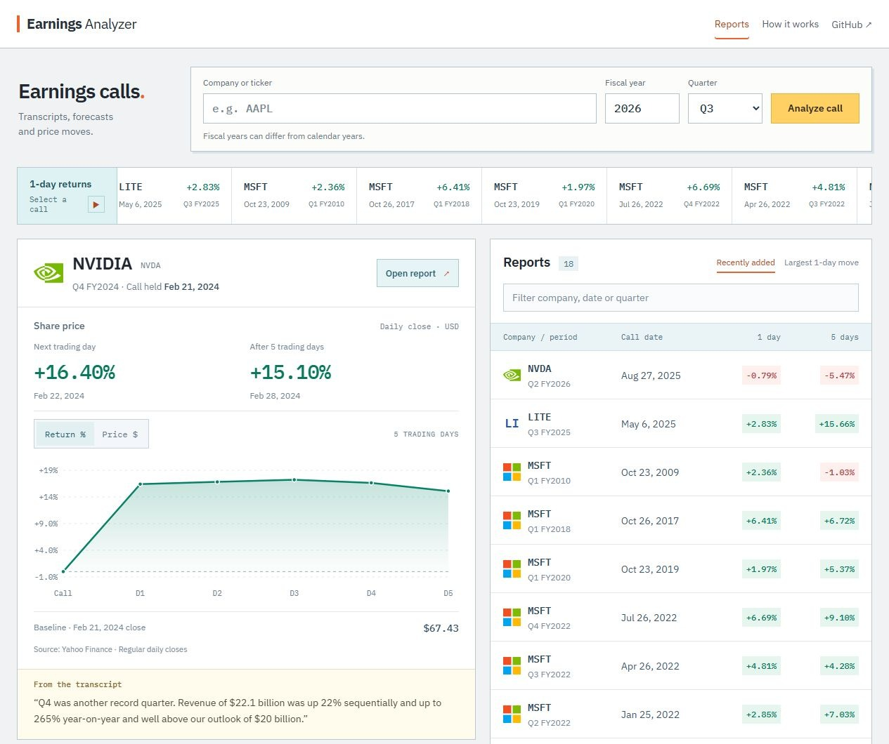
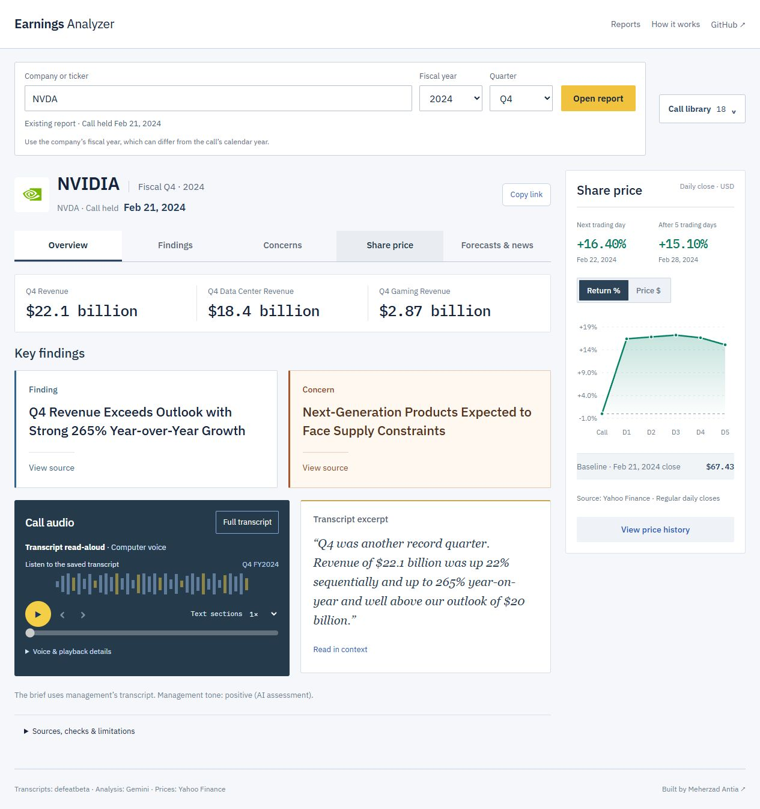

# Earnings Call Analyzer

Earnings calls are long, and the useful parts can be easy to miss. This app pulls together the main results, concerns, and management's outlook, with links back to the transcript so you can check the details yourself.

Choose a company, fiscal year, and quarter, or open a report someone has already run.

**[Try the live app](https://earnings-analyzer-vercel2.vercel.app)**

## What it does

- Uses Gemini to pull out key findings and financial highlights, with supporting transcript excerpts.
- Shows stock price changes over the next trading day, five trading days, or a month.
- Compares earlier revenue guidance with reported results when the periods and figures match, and shows related news links.
- Lets you read the full transcript or listen with browser read-aloud. Original recordings are available for some calls.
- Saves reports in a shared library with links you can reopen without running the AI again.

See an example report

## Built with

React, Vite, and Recharts on the frontend. Python, FastAPI, SQLAlchemy, and PostgreSQL on the backend. Gemini handles the analysis, DuckDB reads transcripts from defeatbeta's public dataset, and yfinance supplies historical prices.

The live app runs on Vercel, with saved reports in Neon PostgreSQL.

## Limits

AI can misread a transcript even when the quotes and numbers match. Reports haven't had independent human review, and stock movements don't prove what caused them. Transcript, price, and news coverage can be incomplete.

## Inside the project

[Architecture and source checks](docs/architecture.md) · [Deployment](docs/deployment.md) · [Asset credits](docs/assets.md)
