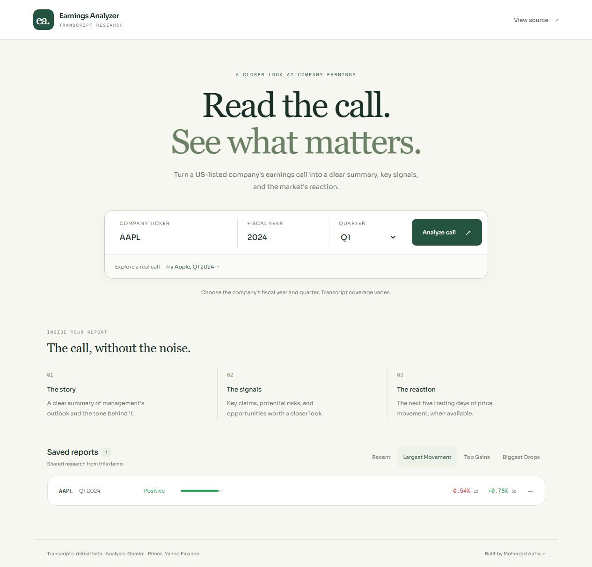

# Earnings Call Analyzer

A full-stack investment research tool that turns earnings call transcripts into 
structured AI-powered reports w/ sentiment, key claims, red flags, opportunities, 
and post-earnings stock price reaction.

The new report format prioritizes up to six findings with separate AI observations and interpretations, inspectable transcript excerpts, financial highlights, and saved report links. It uses one Gemini call per uncached analysis, followed by local source checks.

**Reliability:** exact quote and numeric checks do not establish semantic accuracy. Three development candidates retained 11 of 18 proposed findings after mechanical checks. A separate AI assessment of 18 selected statements judged 12 supported and 6 insufficiently supported; the six interpretations were removed from the curated examples. These are fallible AI judgments. **No independent human review has been performed.** Read the [evaluation method, observed failures, and limitations](docs/evaluation.md); these counts are not a general accuracy rate.

**Public demo:** [earnings-analyzer-vercel2.vercel.app](https://earnings-analyzer-vercel2.vercel.app). Verified end to end on October 18, 2026 with a fresh analysis, prices, saved history, and cached reopening. See [deployment notes](docs/deployment.md).




*Interface preview with a real saved analysis.*

## What it does

Type in a ticker, year, and quarter. The app fetches the earnings call transcript,
runs it through Gemini AI, and returns a clean breakdown of what management said 
and how the market reacted. Results are cached so repeat queries are instant.

The homepage shows every previously analyzed companies, and can be sorted in a variety of ways


## Stack

- **Backend:** FastAPI and SQLAlchemy on Render; PostgreSQL on Supabase Free
- **Frontend:** React, Recharts, Vite: deployed on Vercel
- **AI:** Google Gemini API for transcript analysis
- **Data:** DuckDB reads the requested call from defeatbeta's public Parquet dataset using HTTP range requests; yfinance supplies post-earnings prices.

## Running locally
```bash
# Backend
cd backend
python -m venv venv
source venv/bin/activate  # or venv\Scripts\activate on Windows
pip install -r requirements.txt

# Create a .env file in /backend with:
# DATABASE_URL=postgresql://...
# GEMINI_API_KEY=...

uvicorn main:app --reload
```
```bash
# Frontend
cd frontend
npm install
# Create frontend/.env with VITE_API_BASE_URL=http://127.0.0.1:8000
npm run dev
```

## Features
- AI analysis of US-listed companies with an available transcript for the selected fiscal period
- Small qualitative management-tone indicator, labeled as an AI assessment
- Post-earnings stock price chart (earnings date + 5 trading days)
- Cached analyses with sort by recency, largest movement, top gainers, biggest drops
- Database caching where analyzed transcripts are stored and served instantly on 
  repeat requests
- Optional ticker autocomplete using `VITE_FMP_API_KEY` (Financial Modeling Prep). Direct ticker entry works without it.
- Source-linked observations and separately labeled interpretations; up to four financial highlights.
- Read-only saved reports and transcript context, with shareable `?report=<id>` links.
- Three curated saved calls and [18 source-linked AI assessments with reasons](https://earnings-analyzer-vercel2.vercel.app/review.html), preserving the original failure examples.

## Configuration and checks

Use Python 3.11.17. Set `DATABASE_URL` and `GEMINI_API_KEY` in `backend/.env` locally or in the hosting service's environment. An existing, reachable PostgreSQL database is required for deployment; `render.yaml` does not provision or purchase one. For an isolated local demo, `DATABASE_URL=sqlite:///./local-demo.db` also works.

For an existing PostgreSQL schema, back up reports and apply `backend/migrations/001_research_reports.sql` before starting this version. It adds the nullable `research_json` column; `create_all()` does not migrate existing tables. Original report fields remain stored when a report is upgraded. New empty databases receive the column from the ORM schema.

`GEMINI_MODEL` optionally overrides the existing `gemini-2.5-flash` model. AI availability depends on the configured key's model access and quota. Set `VITE_API_BASE_URL` at frontend build time; without it the app uses the existing Render backend. Values prefixed with `VITE_` are public in the browser; keep backend credentials out of them.

From the repository root:

```bash
python -m unittest discover -s backend
cd frontend
npm run test
npm run build
```

The automated checks use temporary local storage and mock external providers. They never contact the production database or consume AI quota.
